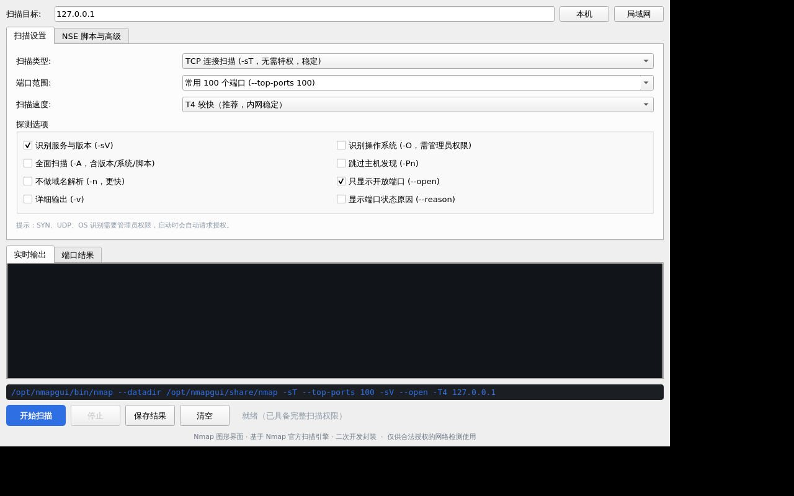
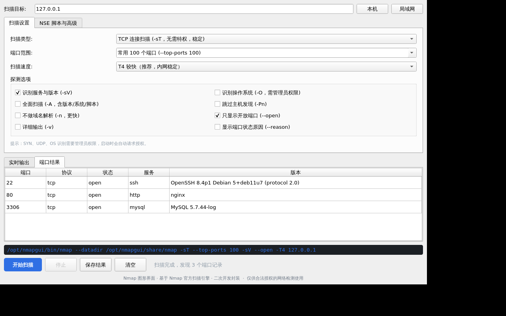

# Nmap 图形界面（银河麒麟 V10 / arm64）

给 Nmap 套一个中文图形界面，做成可直接安装的 deb 包，专为银河麒麟 V10（aarch64 桌面版）打包。





## 特性

- **纯中文界面**：扫描类型、端口范围、探测选项、NSE 脚本全部中文化，命令预览实时可见
- **内置引擎**：打包 Nmap 7.80 与完整 NSE 脚本库（22MB），目标机无需安装 nmap，也不依赖系统 lua/pcap/ssl 版本
- **结果表格化**：自动解析端口/协议/状态/服务/版本，扫描结束自动切换视图，可导出 txt
- **权限自适应**：TCP 连接扫描普通用户可用；SYN/UDP/OS 识别自动调用 pkexec 授权
- **不污染系统**：全部文件装到 `/opt/nmapgui`，自带库通过绝对 RPATH 加载

## 安装

```bash
sudo dpkg -i nmapgui_1.0.0+kylin1_arm64.deb
```

卸载：

```bash
sudo dpkg -r nmapgui
```

装完在开始菜单「网络 / 系统」里找「Nmap 图形界面」，或终端执行 `nmapgui`。

## 环境要求

| 项目 | 要求 |
|---|---|
| 架构 | aarch64 / arm64 |
| 系统 | 银河麒麟 V10 SP2 / SP3（glibc ≥ 2.29） |
| 会话 | X11（Wayland 下会强制走 xcb 兼容模式） |
| 运行库 | libqt5core5a / libqt5gui5 / libqt5widgets5（桌面版自带） |

> V10 SP1 的 glibc 是 2.27，装不上本包。

## 功能页

**扫描设置**

- 扫描类型：TCP 连接 `-sT` / SYN 半开 `-sS` / UDP `-sU` / 主机发现 `-sn` / ACK `-sA` / FIN `-sF`
- 端口范围：常用 100、前 1000、全端口、自定义
- 探测选项：`-sV` 服务版本、`-O` 系统识别、`-A` 全面扫描、`-Pn`、`-n`、`--open`、`-v`、`--reason`
- 扫描速度：T1–T5

**NSE 脚本与高级**

- 脚本类别：default / vuln / discovery / safe / auth
- 指定脚本名与 `--script-args`
- 附加参数：任意 nmap 参数直接追加

**结果区**

- 实时输出：原始 nmap 输出流
- 端口结果：解析后的表格
- 保存结果：导出 txt（含完整命令行）

## 从源码构建

构建环境是 Windows + WSL（Debian），用 debootstrap 建 Ubuntu 20.04 arm64 chroot + qemu-aarch64-static，不做真机编译。

```bash
# 1. 注册 binfmt 并进入 chroot
mount -t binfmt_misc binfmt_misc /proc/sys/fs/binfmt_misc
echo ':qemu-aarch64:M::\x7fELF\x02\x01\x01\x00\x00\x00\x00\x00\x00\x00\x00\x00\x02\x00\xb7\x00:\xff\xff\xff\xff\xff\xff\xff\x00\xff\xff\xff\xff\xff\xff\xff\xff\xfe\xff\xff\xff:/opt/kylin-arm64/usr/bin/qemu-aarch64-static:F' \
  > /proc/sys/fs/binfmt_misc/register
chroot /opt/kylin-arm64 /bin/bash

# 2. 编译 GUI
cd /root/nmapgui && qmake nmapgui.pro && make -j4

# 3. 收集 nmap 与依赖，给 nmap 打绝对 RPATH
apt-get install -y --no-install-recommends nmap patchelf
patchelf --force-rpath --set-rpath /opt/nmapgui/lib /opt/nmapgui/bin/nmap

# 4. 回到宿主机打 deb（纯 Python，不依赖 dpkg-deb）
python3 build/_mkdeb_nmap.py
```

### 关键坑

- **pkexec 会清空环境变量**，`LD_LIBRARY_PATH` 在提权后失效。必须给 nmap 打**绝对路径**的 DT_RPATH（`--force-rpath`），且不能用 `$ORIGIN`——setcap/secure-exec 模式下 `$ORIGIN` 会被忽略。
- Windows 上 `os.stat` 拿不到执行位，手动打 deb 时必须显式给权限表，否则装出来的二进制不可执行。
- 从 Windows 拷进 Linux 的 shell / desktop 文件全部要做 CRLF 归一。

## 验证记录

在 Ubuntu 20.04 arm64 chroot（qemu 模拟，Xvfb 无头 X）中实装验证：

- `dpkg -i` 安装干净，菜单项与图标正常
- 中文渲染无乱码，布局无错位
- 实际扫描 `127.0.0.1`：输出实时刷新，自动生成端口表格，状态栏统计正确
- NSE 脚本执行正常（`--script default` 命中 http-title）
- `env -i /opt/nmapgui/bin/nmap --version` 通过，证明提权后库路径仍可用

## 许可

- 本仓库的 GUI 代码（`src/`、`build/`）采用 MIT 许可
- 内置的 Nmap 引擎与 NSE 脚本版权归 Nmap 项目所有，遵循 [Nmap Public Source License](https://nmap.org/book/man-nmap-license.html)，官方源码见 https://nmap.org/download.html
